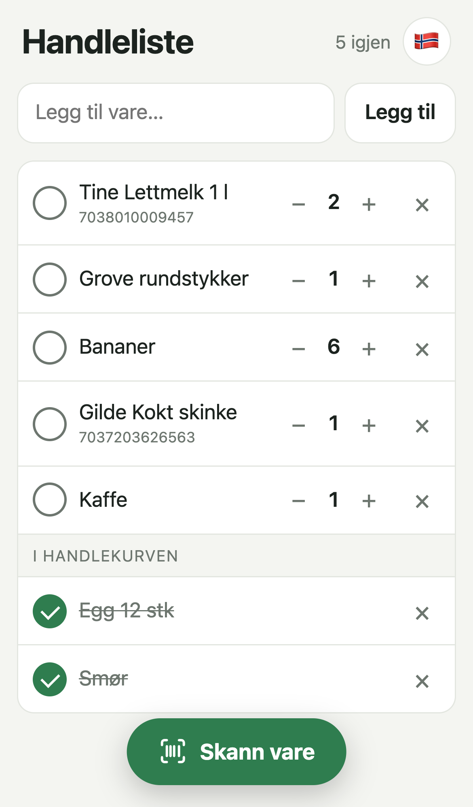
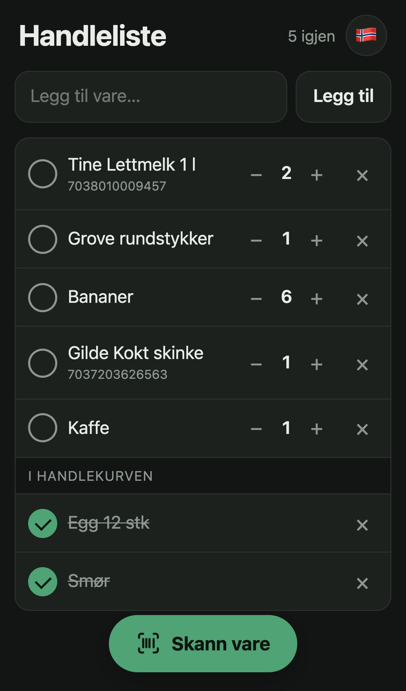
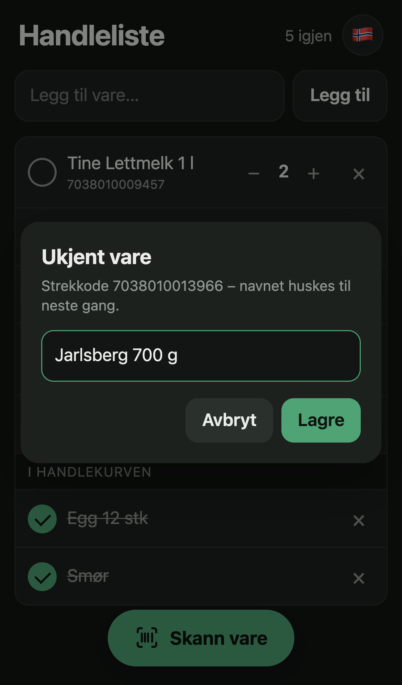

# Handleliste (shoplist-app)

[🇳🇴 Norsk](README.md) · 🇬🇧 English

A shopping list as an offline PWA for iPhone, with a barcode scanner. Plain HTML/CSS/JS with no build step.
The interface is available in Norwegian (default) and English.

<table>
  <tr>
    <td></td>
    <td></td>
    <td></td>
    <td></td>
  </tr>
  <tr>
    <td align="center">Light mode</td>
    <td align="center">Dark mode</td>
    <td align="center">English</td>
    <td align="center">Unknown barcode</td>
  </tr>
</table>

## Features
- Add items by typing them or scanning their barcode (rear camera, ZXing).
- Scanned items are looked up in [Open Food Facts](https://world.openfoodfacts.org). The name is taken
  in the selected language when available, with the brand in front.
- A flag button (🇳🇴/🇬🇧) in the top right switches language. The choice controls both the interface text
  and which product name is fetched from Open Food Facts (Norwegian: `nb → no → default → en`,
  English: `en → default → nb → no`).
- Unknown barcodes get a name you type in. The barcode and name are remembered for next time.
- Adding the same item twice increases the quantity. A typed "Milk" and a scanned "Milk" are merged,
  but two different barcodes never are.
- Checked items move to "In the cart" and can be cleared in one go.
- Light and dark mode follow the system. The app works offline (except for product lookups).

## Files
| File | Contents |
|---|---|
| `index.html` | The whole app: CSS, markup and JS |
| `sw.js` | Service worker. The page is fetched network-first, everything else cache-first. Open Food Facts bypasses the cache. |
| `manifest.webmanifest` | PWA manifest (standalone, portrait) |
| `icons/` | 192, 512 (also maskable) and apple-touch-icon |
| `screenshots/` | README screenshots (not cached by the service worker) |
| `tools/screenshots.mjs` | Regenerates the screenshots (Playwright, see below) |
| `.nojekyll` | Disables Jekyll on GitHub Pages |

All paths are relative, so the app can live in a subfolder (e.g. GitHub Pages).

## Storage (localStorage)
| Key | Contents |
|---|---|
| `handleliste.items_v1` | The list: `{ id, name, barcode, qty, done }[]` |
| `handleliste.barcodes_v1` | Barcode → name the user typed or renamed (takes priority over lookups) |
| `handleliste.lookups_v1` | Barcode → `{ no, en }` from Open Food Facts, so switching language needs no new lookup |
| `handleliste.lang_v1` | Selected language: `no` or `en` |

Data under the old unversioned keys (`handleliste.items`, `handleliste.barcodes`) is migrated
automatically at startup.

## Dependencies
- `@zxing/browser@0.1.5` from unpkg (pinned version, cached by the service worker).
- Open Food Facts API v2 (no key).

## When updating
Bump the `CACHE` version at the top of `sw.js` (e.g. from `handleliste-v4` to `handleliste-v5`) on every
change. Otherwise iOS may keep showing the old version. Close and reopen the app (sometimes twice) to
get the new version.

## Testing
- Locally: `python3 -m http.server 8000` and open http://localhost:8000. The camera works on `localhost`.
- iPhone: the camera requires HTTPS, so host the app on GitHub Pages or Netlify Drop.
  Add it to the home screen via Safari → Share → "Add to Home Screen".
- No automated tests. Test manually in the browser and on iPhone.

## Screenshots
The images in `screenshots/` are made with `tools/screenshots.mjs` (iPhone 13, light/dark mode,
Norwegian/English, sample data in localStorage). Playwright is installed outside the repo, since the app
has no dependencies. The script uses the Chrome you already have installed.

```sh
mkdir -p /tmp/pw && (cd /tmp/pw && npm i playwright@1)
python3 -m http.server 8000                       # in another terminal
PLAYWRIGHT_DIR=/tmp/pw node tools/screenshots.mjs
```

Regenerate the images whenever the look changes.

## Languages
All text lives in `I18N` in `index.html`. Flags and names live in `LANGS`. The text in the HTML is
Norwegian (the default language), so the page doesn't flicker on load. `applyLanguage()` sets the text
of elements with `data-i18n`, `data-i18n-placeholder` and `data-i18n-aria`.

New language: add an entry to `LANGS` and one to `I18N` with the same keys as `no`, and add the name
fields to the order in `lookupProduct()`. The button cycles through the languages in order.

Items already on the list keep the name they were given when added.
The manifest (the name under the home screen icon) is static and in Norwegian.
