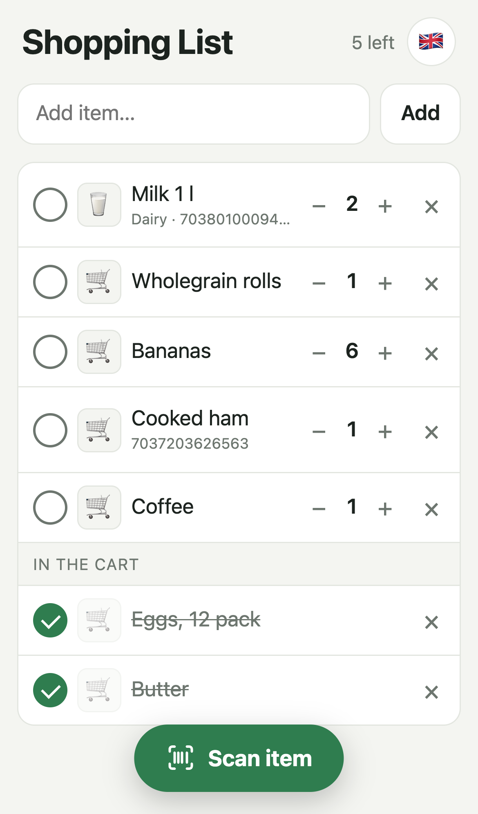
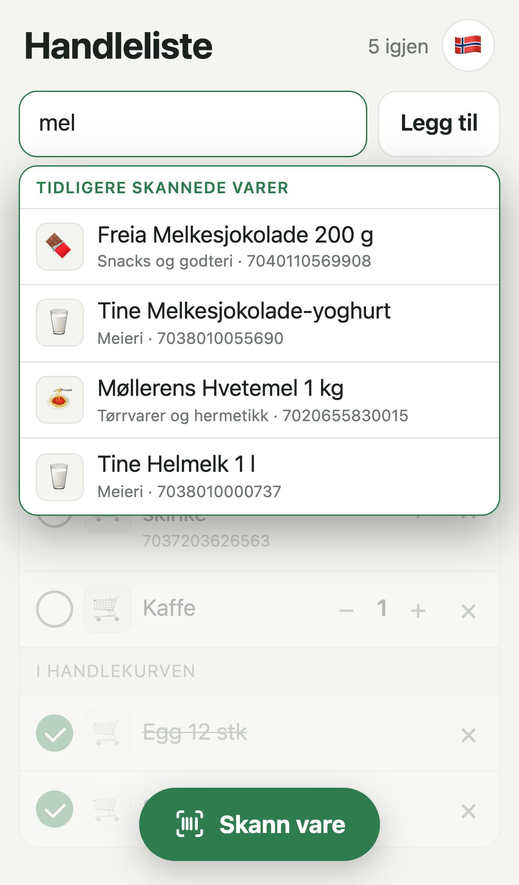

# Handleliste (shoplist-app)

[🇳🇴 Norsk](README.md) · 🇬🇧 English

A shopping list as an offline PWA for iPhone, with a barcode scanner. Plain HTML/CSS/JS with no build step.
The interface is available in Norwegian (default) and English.

**▶ Open the app: [runesor.github.io/shoplist-app](https://runesor.github.io/shoplist-app/)**

<table>
  <tr>
    <td></td>
    <td></td>
    <td></td>
    <td></td>
    <td></td>
  </tr>
  <tr>
    <td align="center">Light mode</td>
    <td align="center">Dark mode</td>
    <td align="center">English</td>
    <td align="center">Unknown barcode</td>
    <td align="center">Search previous items</td>
  </tr>
</table>

## Features
- Add items by typing them or scanning their barcode with the rear camera. On Android (Chrome) the
  browser's built-in `BarcodeDetector` is used, otherwise ZXing (iPhone). On Android the main camera is
  picked automatically with continuous focus, and the ⟳ button in the scanner switches camera if it guesses wrong.
- Scanned items are looked up in [Open Food Facts](https://world.openfoodfacts.org). The name is taken
  in the selected language when available, with the brand in front.
- A flag button (🇳🇴/🇬🇧) in the top right switches language. The choice controls both the interface text
  and which product name is fetched from Open Food Facts (Norwegian: `nb → no → default → en`,
  English: `en → default → nb → no`).
- Scanned items get a small product image from Open Food Facts when one exists. The service worker caches
  the images (max 300), so they also show offline in the store. Tap the name to see the image in full size
  in the rename dialog.
- Scanned items get a category (e.g. "Dairy", "Meat", "Fruit & berries") from Open Food Facts'
  `categories_tags`. It is shown before the barcode under the name and follows the language setting. Without
  an image the category icon is shown (🥛 🥩 🍞 …), and 🛒 for items without a category. Lookups saved before
  categories existed are refreshed in the background at startup.
- While you type in the field, up to 6 matching previously scanned items are shown (from 2 characters,
  both languages, brand included). Items whose name starts with the text come first. Items already on the
  list are hidden. Tap a match to add it with its barcode, image and category. Enter adds what you typed.
  The history is the barcodes in `barcodes_v1` and `lookups_v1`, so search works offline. Items typed in
  without a barcode are not included.
- Unknown barcodes get a name you type in. The barcode and name are remembered for next time.
- Adding the same item twice increases the quantity. A typed "Milk" and a scanned "Milk" are merged,
  but two different barcodes never are.
- Checked items move to "In the cart" and can be cleared in one go.
- Light and dark mode follow the system. The app works offline (except for product lookups).

## Files
| File | Contents |
|---|---|
| `index.html` | The whole app: CSS, markup and JS |
| `sw.js` | Service worker. The page is fetched network-first, everything else cache-first. Product images live in their own cache (`handleliste-images-v1`), kept across updates. Product lookups bypass the cache. |
| `manifest.webmanifest` | PWA manifest (standalone, portrait) |
| `icons/` | 192, 512 (also maskable) and apple-touch-icon |
| `screenshots/` | README screenshots (not cached by the service worker) |
| `tools/screenshots.mjs` | Regenerates the screenshots (Playwright, see below) |
| `.nojekyll` | Disables Jekyll on GitHub Pages |

All paths are relative, so the app can live in a subfolder (e.g. GitHub Pages).

## Storage (localStorage)
| Key | Contents |
|---|---|
| `handleliste.items_v1` | The list: `{ id, name, barcode, qty, done }[]` |
| `handleliste.barcodes_v1` | Barcode → name the user typed or renamed (takes priority over lookups) |
| `handleliste.lookups_v1` | Barcode → `{ no, en, image, imageFull, category }` from Open Food Facts (names, 200/400 px image, category key), so switching language needs no new lookup |
| `handleliste.lang_v1` | Selected language: `no` or `en` |
| `handleliste.camera_v1` | Camera picked with ⟳ (`deviceId`). Missing = automatic choice |

Data under the old unversioned keys (`handleliste.items`, `handleliste.barcodes`) is migrated
automatically at startup.

## Dependencies
- `@zxing/browser@0.1.5` from unpkg (pinned version, cached by the service worker).
- Open Food Facts API v2 (no key).

## When updating
Bump the `CACHE` version at the top of `sw.js` (e.g. from `handleliste-v4` to `handleliste-v5`) on every
change. Otherwise iOS may keep showing the old version. The image cache (`IMAGE_CACHE`) is only bumped for
incompatible changes. Close and reopen the app (sometimes twice) to
get the new version. The number at the bottom of the app ("Version 10") is the number in `CACHE`, read from
the cache the service worker has downloaded, so it shows whether the phone has picked up the new version.

## Testing
- Locally: `python3 -m http.server 8000` and open http://localhost:8000. The camera works on `localhost`.
- iPhone: the camera requires HTTPS. The app is on GitHub Pages (<https://runesor.github.io/shoplist-app/>), published from `main` / root.
  Changes go live a couple of minutes after a push to `main`.
  Add it to the home screen via Safari → Share → "Add to Home Screen".
- Android without publishing: connect the phone to the Mac over USB, open `chrome://inspect` → *Port forwarding*
  (`8000` → `localhost:8000`) and open `http://localhost:8000` in Chrome on the phone. `localhost` counts as
  secure, so the camera works.
- The line at the bottom of the scanner shows which decoder and camera are in use (e.g.
  `BarcodeDetector · camera2 0, facing back`).
- No automated tests. Test manually in the browser, on iPhone and on Android.

## Screenshots
The images in `screenshots/` are made with `tools/screenshots.mjs` (iPhone 13, light/dark mode,
Norwegian/English, sample data in localStorage). Playwright is installed outside the repo, since the app
has no dependencies. The script uses the Chrome you already have installed.

```sh
mkdir -p /tmp/pw && (cd /tmp/pw && npm i playwright@1)
python3 -m http.server 8000                       # in another terminal
PLAYWRIGHT_DIR=/tmp/pw node tools/screenshots.mjs
```

Regenerate the images whenever the look changes.

## Languages
All text lives in `I18N` in `index.html`. Flags and names live in `LANGS`. The text in the HTML is
Norwegian (the default language), so the page doesn't flicker on load. `applyLanguage()` sets the text
of elements with `data-i18n`, `data-i18n-placeholder` and `data-i18n-aria`.

New language: add an entry to `LANGS` and one to `I18N` with the same keys as `no`, and add the name
fields to the order in `lookupProduct()`. The button cycles through the languages in order.

Category names live under `cat` in `I18N`, and the icons in `CATEGORY_ICONS`. The rules that sort Open Food
Facts tags into categories are `CATEGORY_RULES`. The most specific tag is checked first.

Items already on the list keep the name they were given when added.
The manifest (the name under the home screen icon) is static and in Norwegian.
