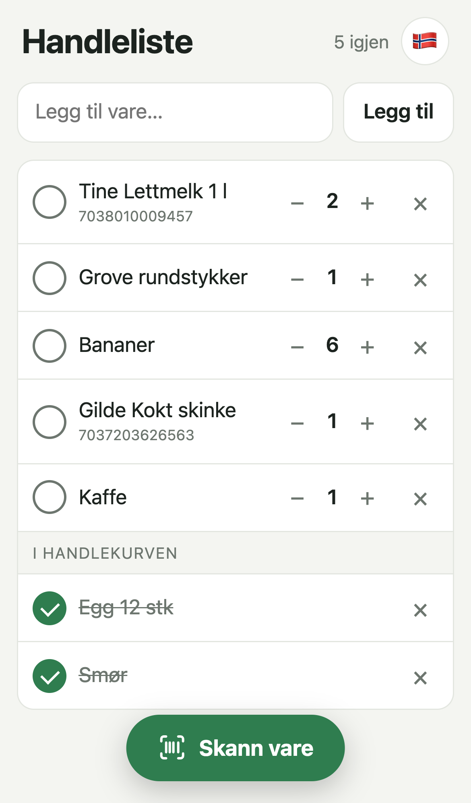
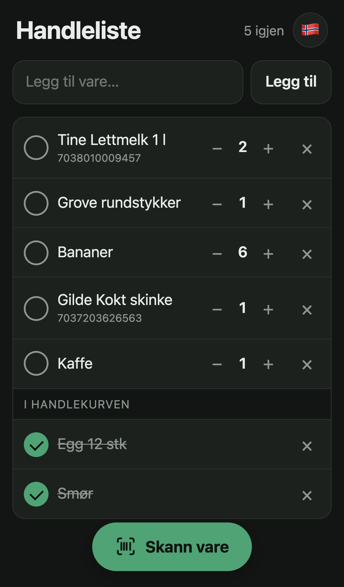
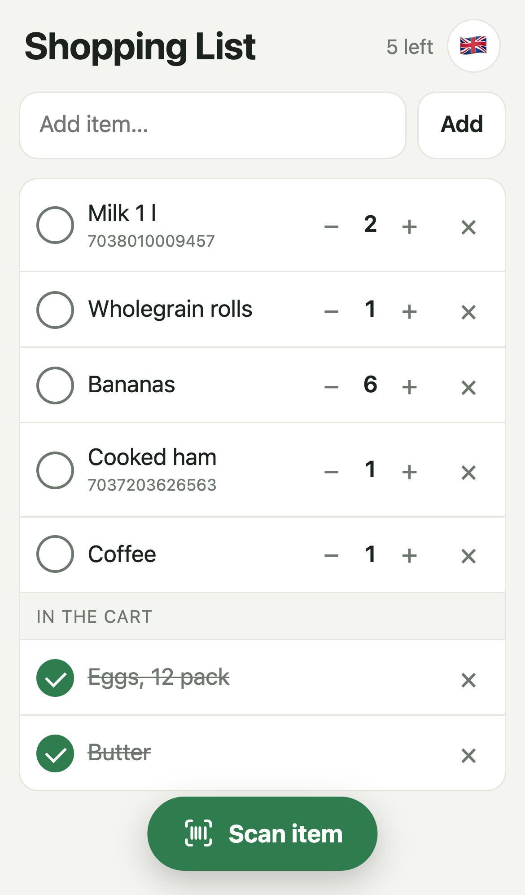
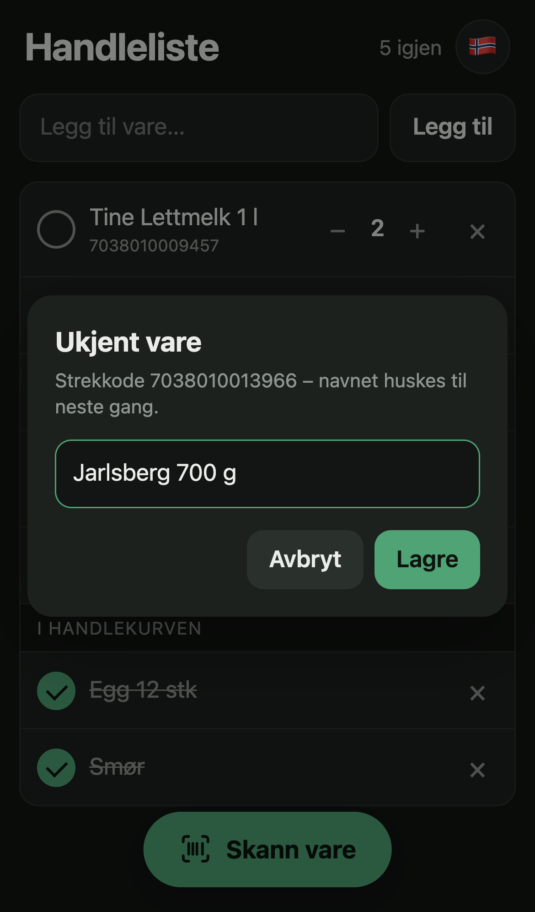

# Handleliste (shoplist-app)

🇳🇴 Norsk · [🇬🇧 English](README.en.md)

Handleliste som offline-PWA for iPhone, med strekkodeskanner. Ren HTML/CSS/JS uten byggesteg.
Grensesnittet finnes på norsk (standard) og engelsk.

<table>
  <tr>
    <td></td>
    <td></td>
    <td></td>
    <td></td>
  </tr>
  <tr>
    <td align="center">Lys modus</td>
    <td align="center">Mørk modus</td>
    <td align="center">Engelsk</td>
    <td align="center">Ukjent strekkode</td>
  </tr>
</table>

## Funksjoner
- Legg til varer ved å skrive dem inn eller skanne strekkoden (bakkamera, ZXing).
- Skannede varer slås opp i [Open Food Facts](https://world.openfoodfacts.org). Navnet hentes på valgt
  språk når det finnes, og merket legges foran.
- Språkknapp med flagg (🇳🇴/🇬🇧) øverst til høyre bytter språk. Valget styrer både teksten i
  grensesnittet og hvilket produktnavn som hentes fra Open Food Facts (norsk: `nb → no → standard → en`,
  engelsk: `en → standard → nb → no`).
- Ukjente strekkoder får et navn du skriver inn. Strekkoden og navnet huskes til neste gang.
- Samme vare to ganger gir høyere antall. En skrevet «Melk» og en skannet «Melk» slås sammen, men
  to ulike strekkoder gjør aldri det.
- Avkryssede varer flyttes til «I handlekurven» og kan fjernes samlet.
- Lys og mørk modus følger systemet. Appen virker offline (bortsett fra produktoppslag).

## Filer
| Fil | Innhold |
|---|---|
| `index.html` | Hele appen: CSS, markup og JS |
| `sw.js` | Service worker. Siden hentes fra nettet først, alt annet fra cachen først. Open Food Facts går forbi cachen. |
| `manifest.webmanifest` | PWA-manifest (standalone, portrett) |
| `icons/` | 192, 512 (også maskable) og apple-touch-icon |
| `screenshots/` | Skjermbilder til README (caches ikke av service workeren) |
| `tools/screenshots.mjs` | Lager skjermbildene på nytt (Playwright, se under) |
| `.nojekyll` | Hindrer Jekyll på GitHub Pages |

Alle stier er relative, så appen kan ligge i en undermappe (f.eks. GitHub Pages).

## Lagring (localStorage)
| Nøkkel | Innhold |
|---|---|
| `handleliste.items_v1` | Listen: `{ id, name, barcode, qty, done }[]` |
| `handleliste.barcodes_v1` | Strekkode → navn brukeren har skrevet inn eller endret (vinner over oppslag) |
| `handleliste.lookups_v1` | Strekkode → `{ no, en }` fra Open Food Facts, så språkbytte ikke krever nytt oppslag |
| `handleliste.lang_v1` | Valgt språk: `no` eller `en` |

Data under de gamle nøklene uten versjon (`handleliste.items`, `handleliste.barcodes`) flyttes
automatisk ved oppstart.

## Avhengigheter
- `@zxing/browser@0.1.5` fra unpkg (låst versjon, caches av service workeren).
- Open Food Facts API v2 (ingen nøkkel).

## Viktig ved oppdatering
Øk `CACHE`-versjonen øverst i `sw.js` (f.eks. fra `handleliste-v4` til `handleliste-v5`) ved hver endring. Ellers kan iOS
fortsette å vise gammel versjon. Lukk og åpne appen (noen ganger to ganger) for å få ny versjon.

## Test
- Lokalt: `python3 -m http.server 8000` og åpne http://localhost:8000. Kameraet virker på `localhost`.
- iPhone: kameraet krever HTTPS, så legg appen på GitHub Pages eller Netlify Drop.
  Legg den til på hjemskjermen via Safari → Del → «Legg til på Hjem-skjerm».
- Ingen automatiske tester. Test manuelt i nettleser og på iPhone.

## Skjermbilder
Bildene i `screenshots/` lages med `tools/screenshots.mjs` (iPhone 13, lys/mørk modus, norsk/engelsk,
eksempeldata i localStorage). Playwright installeres utenfor repoet, siden appen ikke har avhengigheter.
Skriptet bruker Chrome som allerede er installert.

```sh
mkdir -p /tmp/pw && (cd /tmp/pw && npm i playwright@1)
python3 -m http.server 8000                       # i en annen terminal
PLAYWRIGHT_DIR=/tmp/pw node tools/screenshots.mjs
```

Lag bildene på nytt når utseendet endres.

## Språk
All tekst ligger i `I18N` i `index.html`. Flagg og navn ligger i `LANGS`. Teksten i HTML-en er norsk
(standardspråket), så siden ikke blinker ved lasting. `applyLanguage()` setter tekst på elementer med
`data-i18n`, `data-i18n-placeholder` og `data-i18n-aria`.

Nytt språk: legg til en oppføring i `LANGS` og en i `I18N` med de samme nøklene som `no`, og legg til
navnefeltene i rekkefølgen i `lookupProduct()`. Knappen går gjennom språkene i rekkefølge.

Varer som allerede står på listen beholder navnet de fikk da de ble lagt til.
Manifestet (navn under ikonet på hjemskjermen) er statisk og på norsk.
